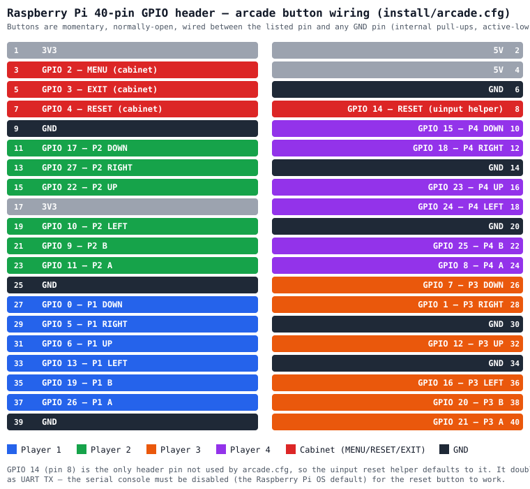

# Creation Station Arcade — Multi Native Kiosk

This branch (`multi-native-arcade`) is a **menu-driven, multi-game launcher** for the native MakeCode Arcade `Game` binary produced by the [PNG to Desktop compiler](https://www.makecode.games/compilers/desktop). It's the native counterpart to the ELF menu flavor on `main`: a MakeCode Arcade game *is* the menu, and it picks which game to launch.

Do **not** merge this branch into `main` or any other kiosk branch. Each kiosk flavor is standalone.

The `Game` binary is a plain SDL2 executable. It does **not** choose a display backend or renderer for you, so you must configure the runtime environment for your target. The two common setups are below.

## Pick your environment

<details>
<summary>Desktop Linux (x86-64, Debian/Ubuntu with a desktop)</summary>

For testing or playing on a regular PC:

1. In the [PNG to Desktop compiler](https://www.makecode.games/compilers/desktop), upload your MakeCode Arcade PNG exports and choose **x86-64** for each.
2. Download the tar.gz files and extract each into a sibling folder:

   ```bash
   mkdir -p ~/Games/Menu ~/Games/MyGame
   tar xzf Menu.tar.gz -C ~/Games/Menu
   tar xzf MyGame.tar.gz -C ~/Games/MyGame
   chmod +x ~/Games/*/Game
   ```

3. Install SDL2 and Mesa:

   ```bash
   sudo apt update
   sudo apt install -y libsdl2-2.0-0 libgl1-mesa-dri
   ```

4. Run the launcher:

   ```bash
   cd /path/to/CreationStationArcade
   ./launcher.sh
   ```

   SDL will use X11 or Wayland automatically with the default OpenGL renderer. To run a single game by hand, `cd` into its folder and use `./Game -f`.

</details>

<details>
<summary>Standalone arcade cabinet (ARM64, e.g., Raspberry Pi, no desktop)</summary>

For a Pi or similar ARM board that boots straight into the menu:

- Supported Pi models: Pi 3, Pi 4, Pi 5, and Pi Zero 2 W (all with a 64-bit OS). Original Pi Zero / Pi 1 are not supported because the `Game` binary is `aarch64`.

1. In the [PNG to Desktop compiler](https://www.makecode.games/compilers/desktop), upload your MakeCode Arcade PNG exports and choose **arm64** — including the **menu project**, which must be built with the menu-enabled runtime (see "How it works").
2. On the target machine:

   ```bash
   sudo apt update && sudo apt install -y git
   git clone -b multi-native-arcade https://github.com/Kikketer/CreationStationArcade /home/pi/CreationStationArcade
   cd /home/pi/CreationStationArcade
   # extract each game into games/<Name>/ first, then:
   sudo bash install/multi-native-arcade-setup.sh --gpio
   sudo reboot
   ```

   The installer handles:
   - Packages: `libsdl2-2.0-0`, `libdrm2`, `libgbm1`, `libudev1`, `libasound2`, `libgl1-mesa-dri`, `libegl1`, `libgles2`, `python3-rpi.gpio`
   - User groups: `video`, `input`, `audio`, `gpio`
   - Pi `vc4-kms-v3d,cma-128` overlay (when a Raspberry Pi is detected)
   - `getty@tty1` autologin and the auto-launch block in `~/.bash_profile`/`~/.profile`
   - Runtime environment: `SDL_VIDEODRIVER=kmsdrm` and `SDL_RENDER_DRIVER=opengles2`
   - USB game-update udev rule + service

3. After reboot, the cabinet boots straight into `games/Menu/Game -f`, or the first valid game if no menu is installed.

For non-Pi ARM boards like La Frite, use `install/la-frite-native-arcade-setup.sh` instead (see its `--help`).

#### GPIO reset button

A dedicated cabinet reset button is supported out of the box. It triggers the native `Game`'s soft reset (`control.reset`) by injecting the `r` key through a uinput virtual keyboard, so the `Game` process never exits.

Default wiring:

- Connect one side of a momentary normally-open switch to **GPIO 14** (physical pin **8**).
- Connect the other side to **GND** (physical pin **6**, right next to pin 8).

Pin layout for a 2-pin connector:

```
Pin 8   GPIO 14  -> one switch wire
Pin 6   GND      -> other switch wire
```

GPIO 14 is the only header pin left unassigned by the default `/etc/arcade.cfg` button map, so it can never conflict with a player button. It doubles as UART TX, so the serial console must be disabled (the Raspberry Pi OS default).

Because the switch pulls the pin to ground, `launcher.sh` runs `gpio-reset-keyboard.py` with `--active-low`. To use a different ground-adjacent GPIO, set `GPIO_RESET_PIN` in the launcher or before reboot. To use an active-high (3.3 V) button instead, set `GPIO_RESET_ACTIVE_HIGH=1`.

To disable autolaunch for debugging, see `notes.md` or run `./toggle-arcade.sh disable`.

</details>

## Hardware requirements

- 64-bit Raspberry Pi or PC running a 64-bit Debian-based Linux (`arm64` or `x86-64`).
  - For Raspberry Pi, the installer enables the `vc4-kms-v3d` overlay in `/boot/firmware/config.txt` (or `/boot/config.txt`) so KMSDRM has a DRM device.
- SDL2 / GL runtime libraries installed by the installer (`libsdl2-2.0-0`, `libdrm2`, `libgbm1`, `libudev1`, `libasound2`, `libgl1-mesa-dri`, `libegl1`, `libgles2`).
- The arcade user must belong to the `video` group for KMSDRM.

## How it works

- `install/multi-native-arcade-setup.sh` installs packages, adds the user to required groups, enables `getty@tty1` autologin, and writes the auto-launch block into `~/.bash_profile` and `~/.profile`.
- On boot, the autologin shell runs `launcher.sh` from the checkout directory (`/home/pi/CreationStationArcade`).
- `launcher.sh` sets `SDL_VIDEODRIVER=kmsdrm`, `SDL_AUDIODRIVER=alsa`, and `SDL_RENDER_DRIVER=opengles2` on `aarch64`, exports the two menu hooks below, and runs a **menu → game → menu** loop via `launch-game.sh`.

### The menu contract (the "control" hook)

This replaces the `control`-based ELF launching the `main` branch used — where the menu `.elf` fork+exec'd the chosen `.elf` and killed itself. Two environment variables carry the whole contract, so the compiler/runtime only needs a small hook:

- `ARCADE_GAMES_DIR` — absolute path to the `games/` directory. The menu scans it for `<Name>/Game` to build the playable list.
- `ARCADE_LAUNCH_FILE` — path to the launch-request file (default `/tmp/creationstation_launch_request`). To launch a game, the menu writes the game's directory name (one line, `[A-Za-z0-9._-]`) to this file and then exits — the same "the menu kills itself" behavior as the ELF menu. This is what a `control.runProgram(name)`-style API should compile to on the native target.

Then `launcher.sh` does the rest:

1. Reads `$ARCADE_LAUNCH_FILE`. If it names an installed `games/<Name>/`, that game runs; otherwise the menu (`games/Menu/`, override with `ARCADE_MENU_NAME`) runs.
2. When the running `Game` exits — finished, `BTN_EXIT`, or crash — the loop comes back around and relaunches whatever is requested (usually the menu again).
3. A non-menu game that fails 5 times in a row is skipped so the cabinet lands back on a working menu.

The USB installer also writes to the launch-request file, so a USB game install switches to the new game live — no reboot.

## Add a game from the PNG to Desktop compiler

1. In the [PNG to Desktop compiler](https://www.makecode.games/compilers/desktop), upload your MakeCode Arcade PNG export and choose the target architecture:
   - `arm64` for Raspberry Pi / ARM arcade cabinets
   - `x86-64` for desktop Linux PCs
2. Download the `SafeName{-arm64}.tar.gz` archive.
3. Extract into `games/<Name>/`:

   ```bash
   cd /home/pi/CreationStationArcade
   mkdir -p games/SafeName
   tar xzf SafeName-arm64.tar.gz -C games/SafeName
   chmod +x games/SafeName/Game
   ```

   The archive contains `Game` and `libpxt.so`; both must stay in `games/SafeName/`.

4. That's it — the game shows up in the menu automatically (the menu rescans `games/` each time it starts). Commit and push the branch if you want git to be the source of truth.

## Add a game by USB stick

The installer sets up a udev rule + `arcade-usb-update@.service` so inserting a USB drive containing a game installs it and switches to it immediately. Two ways to get a game on the stick:

- **Just drop the `.tar.gz` on it** — the exact file the [PNG to Desktop compiler](https://www.makecode.games/compilers/desktop) downloads (e.g. `MyGame-arm64.tar.gz`) at the drive root. In Chrome/Edge you can even check "Write to a USB cartridge" on the compiler page and it writes the file straight to the stick for you.
- **Or an extracted `arcade-game/` folder** at the drive root:

  ```
  arcade-game/
    Game         # required — native binary built for the box's architecture
    libpxt.so    # required
    name.txt     # optional — one line, becomes games/<Name>
    arcade.cfg   # optional — copied to /etc/arcade.cfg (GPIO buttons)
  ```

The box extracts the archive, checks for `Game` + `libpxt.so`, names the game from the filename (a `name.txt` inside overrides it), installs it into `games/` alongside the existing games, writes a launch request, and kills the running `Game` — so the new game starts right away. Any drive without a game is ignored, and a binary built for the wrong architecture is refused. Progress is logged to `arcade.log` and the journal (`journalctl -u 'arcade-usb-update@*'`).

## Kill or restart the game

- **Back to the menu**: exit the running game (`BTN_EXIT` on GPIO, or however the game exits). `launcher.sh` relaunches the menu automatically.
- **In-game reset**: the native `Game` handles reset via the `r` / `R` key. Your USB controller's reset mapping depends on its button-to-key configuration.
- **SSH recovery**: log in as an admin user and run:

  ```bash
  sudo pkill -9 -f "games/[^/]+/Game"
  sudo pkill -9 -f launcher.sh
  ```

  Then see `notes.md` for restoring the launcher shell.

## Input strategy

USB gamepads and zero-delay encoders that appear as `/dev/input/js*` or `/dev/input/event*` are handled directly by the native `Game` binary. No Python input bridge is required.

**GPIO buttons:** the `Game` binary also reads `/etc/arcade.cfg` at startup (Linux only). When present, GPIO pins listed there become player buttons — edge-triggered via `/dev/gpiochip*`, so there's no polling overhead. Run the installer with `--gpio` to install the default pin map (`install/arcade.cfg`, same BCM layout as the ELF flavor's `arcade.cfg`), or write your own `/etc/arcade.cfg`:

```bash
sudo bash install/multi-native-arcade-setup.sh --gpio
```

The default pin map supports up to 4 players plus cabinet MENU/RESET/EXIT buttons. Each button is a momentary normally-open switch wired between its pin and any GND pin (all 8 GND header pins are equivalent — pick the closest one):



On a machine with no config file (or no `/dev/gpiochip*`), GPIO input is simply off — the same `Game` binary runs on a regular computer with keyboard/joystick unchanged. Point `ARCADE_GPIO_CFG` at a different file to override the location.

## Branch safety

- Do **not** merge `multi-native-arcade` into `main`.
- Keep this branch minimal: only the files required to clone, install, and boot the menu + games.
